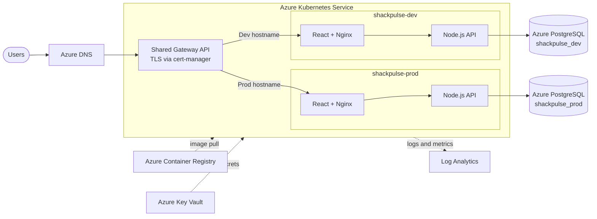
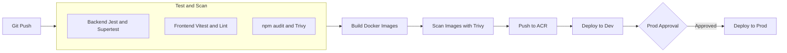

<div align="center">

# ShackPulse

### A corporate-style project portfolio, deployed with Azure AKS and Azure DevOps


**React + Node.js + PostgreSQL application running on AKS with Dev and Prod environments, secure secret management, automated testing, container scanning, and approval-based deployments.**

[Quick Start](#quick-start) · [Architecture](#architecture) · [CI/CD](#cicd-pipeline) · [Azure Infrastructure](#azure-infrastructure) · [Local Development](#local-development)

</div>

---

## Overview

ShackPulse is a corporate-style internal project management portal for tracking projects, clients, team members, budgets, progress, milestones, health status, and access requests.

It demonstrates how to build and operate a complete application on Azure rather than deploying a basic hello-world example:

- React 19 frontend with Vite
- Node.js 22 and Express 5 API
- PostgreSQL database
- Docker-based delivery
- Azure Kubernetes Service for Dev and Prod workloads
- Azure DevOps CI/CD with environment approvals
- Trivy security scans and npm audits
- Azure Key Vault for sensitive values
- Gateway API, Cilium, cert-manager, autoscaling, and network policies

> This repository is for hands-on implementation and portfolio demonstration. Production secrets and Azure resources are not included.

---

## Features

### Application

- Project, client, people, and milestone management
- Portfolio dashboard with project-health visibility
- Budget, priority, progress, and due-date tracking
- CSV project export
- Structured health and metrics endpoints
- Role-based access: Admin, Project Manager, Member, and Viewer
- Admin approval workflow for pending access requests

### Platform

- Separate AKS namespaces for Dev and Prod
- Managed Azure PostgreSQL outside the Kubernetes cluster
- Shared Gateway API entry point with hostname routing
- Automatic TLS with cert-manager and Let's Encrypt
- Horizontal Pod Autoscaling and Pod Disruption Budgets
- Default-deny network policies
- Centralized logs and metrics with Container Insights
- Traceable container images tagged by pipeline build and labelled with source metadata

---

## Tech Stack

| Area | Technologies |
|---|---|
| Frontend | React 19, Vite, CSS, Nginx, React Router |
| Backend | Node.js 22, Express 5, JWT, Zod |
| Database | PostgreSQL 16 |
| Testing | Jest, Supertest, Vitest, Testing Library, oxlint |
| Containers | Docker, Docker Compose, Azure Container Registry |
| Kubernetes | Azure Kubernetes Service, Cilium, Gateway API, Kustomize |
| Kubernetes Operations | HPA, PDB, network policies, HTTPS redirects |
| CI/CD | Azure Repos, Azure Pipelines YAML, self-hosted Azure agent |
| Security | Trivy, npm audit, Azure Key Vault, RBAC-style application roles |
| Networking | Azure DNS, cert-manager, Let's Encrypt |
| Observability | Azure Log Analytics, Container Insights, Prometheus-style `/metrics`, JSON logs |

---

## Architecture



### Request Flow

1. Azure DNS resolves the Dev or Prod hostname to the shared Gateway address.
2. The Gateway terminates TLS and uses an `HTTPRoute` to select the environment.
3. Nginx serves the React application and forwards API requests to the Node.js service.
4. The API executes SQL queries against the managed PostgreSQL database.
5. The response follows the same path back to the browser.
6. Plain HTTP is redirected to HTTPS.

Each namespace uses default-deny network policies that permit only the required traffic paths: Gateway to web and web to API.

---

## Repository Structure

```text
.
├── azure-pipelines.yml          # Main CI/CD pipeline
├── pipelines/templates/         # Reusable AKS deployment and Trivy templates
├── infra/
│   ├── setup-azure.sh           # Creates Azure platform resources
│   └── teardown.sh              # Removes provisioned resources
├── k8s/
│   ├── base/                    # Deployments, services, HPA, PDB, routes and policies
│   ├── overlays/dev/            # Development namespace configuration
│   ├── overlays/prod/           # Production namespace configuration
│   └── platform/                # Shared Gateway and Let's Encrypt ClusterIssuer
├── backend/
│   ├── src/                     # API, database, middleware and routes
│   └── tests/                   # Jest and Supertest test suites
├── frontend/
│   ├── src/                     # React application and components
│   └── src/test/                # Vitest test suites
└── docker-compose.yml           # Complete local application stack
```

---

## Quick Start

### Prerequisites

- Docker Desktop or Docker Engine
- Docker Compose
- 4 GB RAM or more recommended
- Git

### Run Locally

```bash
git clone https://github.com/SathwickDutt/Azure-DevOps-Project.git
cd Azure-DevOps-Project
docker compose up --build
```

Open:

```text
http://localhost:3000
```

The database is migrated and seeded automatically on first startup.

### Local Demo Accounts

| Role | Email | Password |
|---|---|---|
| Admin | `admin@devopsshack.com` | `Admin@123` |
| Project Manager | `rohan.mehta@devopsshack.com` | `Demo@1234` |
| Member | `arjun.reddy@devopsshack.com` | `Demo@1234` |
| Viewer | `divya.krishnan@devopsshack.com` | `Demo@1234` |

These credentials are seed data for local Docker runs only.

### Stop the Local Environment

```bash
docker compose down
```

To remove local database data as well:

```bash
docker compose down -v
```

---

## Local Development

### Backend

```bash
cd backend
npm ci
npm run dev
```

Backend scripts include migrations, seeds, tests, coverage, and a CI test run:

```bash
npm run migrate
npm run seed
npm test
npm run test:ci
```

### Frontend

```bash
cd frontend
npm ci
npm run dev
```

Frontend scripts:

```bash
npm run lint
npm run test
npm run test:ci
npm run build
npm run preview
```

---

## Azure Infrastructure

Infrastructure is created through [`infra/setup-azure.sh`](infra/setup-azure.sh) instead of manual resource-by-resource setup.

The script provisions:

1. Azure Resource Group
2. Azure Container Registry
3. Log Analytics workspace
4. AKS cluster with Cilium networking and cluster autoscaling
5. Azure Key Vault
6. Managed Azure PostgreSQL Flexible Server
7. Azure service principal for pipeline identity
8. Shared Gateway and cert-manager components
9. Azure DNS zone
10. Self-hosted Azure Pipelines agent virtual machine

### Infrastructure Requirements

- Azure subscription with permission to create the required resources
- Azure CLI authenticated to the correct subscription
- Custom domain for public access
- Email address for Let's Encrypt notifications
- Unique names for Azure resources that require global uniqueness

Review resource names, region, domain, and email settings in `infra/setup-azure.sh` before execution.

### Provision Azure Resources

```bash
cd infra
bash setup-azure.sh
```

After provisioning, store the returned subscription, tenant, service-principal, resource, registry, and DNS details securely.

### Remove Azure Resources

```bash
cd infra
bash teardown.sh
```

> Teardown permanently deletes the configured resource group and its resources. Review the script before running it.

---

## CI/CD Pipeline

The pipeline is defined in [`azure-pipelines.yml`](azure-pipelines.yml) and reuses [`pipelines/templates/deploy-aks.yml`](pipelines/templates/deploy-aks.yml) for both environments.



### Pipeline Stages

1. **Backend CI**
   - Runs 48 Jest/Supertest tests against a real PostgreSQL test container
   - Publishes test results and coverage

2. **Frontend CI**
   - Runs oxlint
   - Runs 18 Vitest tests
   - Creates a production build

3. **Security checks**
   - Audits npm dependencies
   - Scans source files for vulnerabilities and secrets
   - Scans Kubernetes manifests and Dockerfiles

4. **Image build**
   - Builds API and web container images
   - Scans critical vulnerabilities with Trivy
   - Pushes images to Azure Container Registry

5. **Dev deployment**
   - Retrieves secrets from Azure Key Vault
   - Applies the Kustomize environment overlay
   - Waits for API and web rollouts
   - Verifies Gateway routing and TLS readiness
   - Runs an HTTPS smoke test

6. **Prod deployment**
   - Requires approval in the `shackpulse-prod` Azure DevOps environment
   - Applies the same tested deployment process with production values

### Pipeline Security

- Pull requests do not build or push container images
- Images are tagged with the Azure DevOps build ID
- Images include source revision and repository labels
- Database passwords, JWT secrets, and seed credentials come from Key Vault
- Service-principal permissions are limited to the resources required by the pipeline
- An approval check protects every production deployment

---

## Kubernetes Configuration

| Setting | Dev | Prod |
|---|---|---|
| Namespace | `shackpulse-dev` | `shackpulse-prod` |
| Hostname | `shackpulse-dev.<domain>` | `shackpulse.<domain>` |
| Database | `shackpulse_dev` | `shackpulse_prod` |
| API Replicas | 1, HPA up to 2 | 2, HPA up to 5 |
| Demo Logins | Enabled locally | Disabled by environment configuration |

The manifests use Kustomize:

- `k8s/base` — shared deployments, services, HPA, PDB, network policies, and HTTPRoute
- `k8s/overlays/dev` — development namespace and values
- `k8s/overlays/prod` — production namespace and values
- `k8s/platform` — shared Gateway and Let's Encrypt ClusterIssuer

### Operations Endpoints

- `GET /healthz` — process health
- `GET /readyz` — database readiness
- `GET /metrics` — Prometheus-style application metrics

---

## Testing

Run backend tests:

```bash
cd backend
npm ci
npm run test:ci
```

Run frontend tests and lint:

```bash
cd frontend
npm ci
npm run lint
npm run test:ci
npm run build
```

The frontend and backend test suites also run in the Azure pipeline before image builds and deployments.

---

## Configuration

Azure and Kubernetes configuration is supplied through pipeline variables, Kustomize overlays, environment variables, and Azure Key Vault.

Typical application values include:

```text
DB_HOST
DB_PORT
DB_NAME
DB_USER
DB_PASSWORD
JWT_SECRET
ADMIN_PASSWORD
ACR_LOGIN_SERVER
APP_HOST
APP_VERSION
BUILD_ID
COMMIT_SHA
```

Do not commit real database passwords, JWT secrets, service-principal secrets, or Azure credentials to the repository.

---

## Cleanup

Remove the local containers and volumes:

```bash
docker compose down -v
```

Delete the Azure environment:

```bash
cd infra
bash teardown.sh
```

---

## Contributing

1. Fork the repository.
2. Create a feature branch.
3. Run frontend and backend tests before submitting changes.
4. Ensure Docker and Kubernetes configuration validation passes.
5. Open a pull request with a clear summary and test evidence.

---

## License

This project is currently distributed with an `UNLICENSED` package configuration. Add a `LICENSE` file if you intend to publish it for public reuse.
