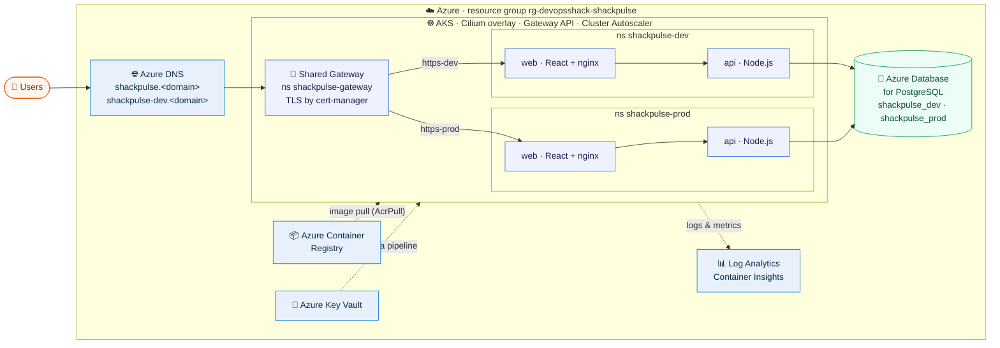
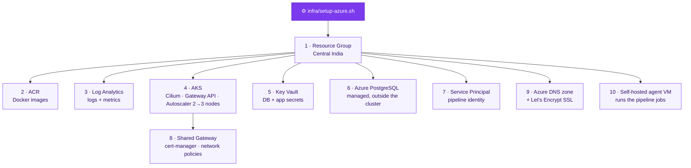
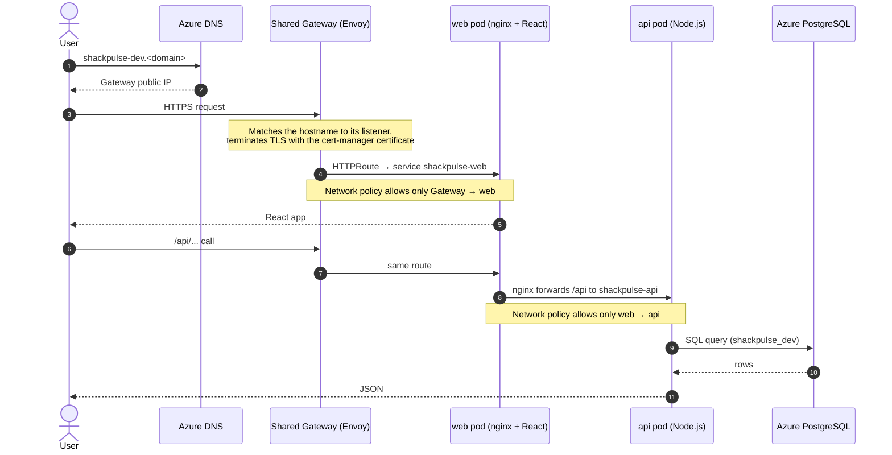

<div align="center">

# ShackPulse

### A corporate-style internal project tracker, shipped to Azure AKS with a production-grade Azure DevOps pipeline

**Azure DevOps** · **AKS** · **Gateway API** · **Cilium** · **Key Vault** · **Azure PostgreSQL** · **Trivy** · **cert-manager**

---

## 📌 What is this project?

Every company has an internal portal that answers the same questions every week: *Which projects are running? Which client is each one for? Who owns it? Is it on track? When is it due?*

**ShackPulse** is that portal. We built it the way such tools are built inside real companies, and we deploy it the way a real platform team would: infrastructure from a script, images scanned before they reach the registry, secrets kept in Key Vault, and nothing reaching production without a human approving it.

Most DevOps tutorials deploy a "Hello World" or a to-do app. You can't learn how production works from those, because they have none of the moving parts a real application has. ShackPulse has all of them: login and roles, a real database, an access-request workflow, a dev and a prod environment, HTTPS on a custom domain, and a pipeline with quality gates.

> 🎥 The full build, from an empty Azure subscription to a live app on Dev and Prod, is on the [DevOps Shack YouTube channel](https://www.youtube.com/@devopsshack).

---

## ✨ What the application does

ShackPulse is a three-tier web app: a React front end, a Node.js API and a PostgreSQL database.

- **Projects:** each project has its client, owner, health, priority, progress, budget, milestones, time entries and status updates. Projects can be exported as CSV.
- **Clients:** every client company, with its points of contact and the projects we run for it.
- **People:** who works on what, with their title and department.
- **Dashboard:** portfolio health at a glance, with charts.
- **Roles:** Admin, Project Manager, Member and Viewer, each seeing and doing only what the role allows.
- **Access requests:** a new team member signs up with their company email, and the account stays *pending* until an admin approves it and picks a role. This is exactly how internal tools are onboarded in companies.
- **Operations endpoints:** `/healthz` and `/readyz` for Kubernetes probes, `/metrics` for Prometheus-style metrics, and structured JSON logs.

---

## 🏗 Architecture

Everything lives in one Azure resource group. The app runs on AKS in two namespaces, `shackpulse-dev` and `shackpulse-prod`. A single shared Gateway in front of them serves both hostnames over HTTPS.



**Why the database sits outside the cluster.** We run PostgreSQL as a managed Azure service, not as a pod. Microsoft handles backups, patching and version upgrades, and the data survives even if we delete and rebuild the whole cluster. One server holds two databases, each with its own login, so dev can never read prod data.

**Why the shared Gateway.** With Gateway API we run one Gateway with one public IP and give it a listener per hostname. Each environment attaches its own `HTTPRoute`, so dev and prod are routed independently while sharing the same entry point and certificates.

---

## 🧱 Infrastructure

The whole platform is created by one script, [`infra/setup-azure.sh`](infra/setup-azure.sh), in a few minutes instead of clicking through the portal resource by resource. [`infra/teardown.sh`](infra/teardown.sh) removes everything again.



A few decisions worth knowing about:

- **Service principal = an identity for software.** People sign in with a username and password. A pipeline needs an identity too, and that is the service principal. It gets exactly three permissions: Contributor on the resource group (to reach AKS), AcrPush (to push images) and Key Vault Secrets User (to read secrets).
- **No passwords in YAML.** Database passwords, the JWT secret and the admin password live in Key Vault. The pipeline reads them through a variable group linked to the vault.
- **Free HTTPS.** Azure has no built-in certificate service like AWS ACM, so cert-manager requests certificates from Let's Encrypt and renews them automatically.
- **Self-hosted agent.** Microsoft-hosted agents need a free-tier request on new organisations, so our pipeline jobs run on our own small Linux VM with Docker, Azure CLI, kubectl and Trivy installed.

---

## 🔄 The CI/CD pipeline

[`azure-pipelines.yml`](azure-pipelines.yml) is the main pipeline. Both deploy stages reuse one template, [`pipelines/templates/deploy-aks.yml`](pipelines/templates/deploy-aks.yml), so the dev deployment is a true rehearsal of the prod one.

```mermaid
flowchart LR
    G(["git push<br/>Azure Repos"]) --> CI

    subgraph CI["🧪 CI · test & scan"]
        direction TB
        B1["Backend<br/>48 Jest tests<br/>on real PostgreSQL"]
        B2["Frontend<br/>lint · 18 Vitest tests<br/>production build"]
        B3["Security<br/>npm audit · Trivy<br/>vulns · secrets · IaC"]
    end

    CI --> BU["🐳 Build<br/>docker build → Trivy scan<br/>→ push to ACR"]
    BU --> DD["🚀 Deploy DEV<br/>Key Vault secrets → kubectl apply -k<br/>Gateway check → HTTPS smoke test"]
    DD --> AP{"✋ Manual approval<br/>shackpulse-prod"}
    AP -->|approved| DP["🏁 Deploy PROD<br/>same template, prod values"]

    classDef ci fill:#ecfeff,stroke:#0891b2,color:#164e63
    classDef build fill:#eff6ff,stroke:#2563eb,color:#1e3a8a
    classDef dev fill:#f0fdf4,stroke:#16a34a,color:#14532d
    classDef gate fill:#fef9c3,stroke:#ca8a04,color:#713f12
    classDef prod fill:#fdf2f8,stroke:#db2777,color:#831843
    class B1,B2,B3 ci
    class BU build
    class DD dev
    class AP gate
    class DP prod
```



What makes it production-grade:

- **Quality gates stop bad code early.** If a test fails, or Trivy finds a critical vulnerability or a leaked secret, the pipeline stops before anything is built or deployed.
- **An image that fails its scan never reaches the registry.** Each image is scanned after it is built and before it is pushed.
- **Every image is traceable.** Images are tagged with the pipeline run ID and labelled with the commit, so we always know which run built what is running.
- **Prod waits for a human.** The `shackpulse-prod` environment has an approval check. After dev is deployed and checked, someone approves, and only then does prod deploy. The approval can wait for days.
- **Deployments are verified.** After applying the manifests, the pipeline confirms the Gateway accepted the route and runs an HTTPS smoke test against the live URL.

---

## 🌐 How a request travels through the app



Plain HTTP is never served: a dedicated `http-to-https` route answers with a redirect. Inside each namespace, a default-deny network policy blocks all incoming traffic, and only two paths are opened: Gateway → web and web → API. Any other pod in the cluster that tries to call our API is blocked. Cilium enforces these rules.

---

## ☸️ Kubernetes setup

| | Dev | Prod |
| --- | --- | --- |
| Namespace | `shackpulse-dev` | `shackpulse-prod` |
| URL | `shackpulse-dev.<domain>` | `shackpulse.<domain>` |
| Database | `shackpulse_dev` | `shackpulse_prod` |
| API replicas | 1 (HPA up to 2) | 2 (HPA 2 → 5 at 70% CPU) |
| Demo logins | On | Off |

The manifests use **Kustomize**: a shared `base` and an overlay per environment.

- `k8s/base`: Deployments, Services, HPA, PodDisruptionBudget, network policies and the `HTTPRoute`.
- `k8s/overlays/dev` and `k8s/overlays/prod`: namespace, config, replica counts and hostname for each environment.
- `k8s/platform`: the shared Gateway and the Let's Encrypt `ClusterIssuer`, applied once by the setup script.

---

## 🗂 Repository structure

```
.
├── azure-pipelines.yml          # Main CI/CD pipeline: CI → Build → Deploy DEV → approval → Deploy PROD
├── pipelines/templates/
│   ├── deploy-aks.yml           # Reusable deploy job used by both environments
│   └── install-trivy.yml        # Installs Trivy on the agent
├── infra/
│   ├── setup-azure.sh           # Creates the whole Azure platform
│   └── teardown.sh              # Deletes it again
├── k8s/
│   ├── base/                    # Deployments, Services, HPA, PDB, network policies, HTTPRoute
│   ├── overlays/dev|prod/       # Per-environment Kustomize overlays
│   └── platform/                # Shared Gateway + Let's Encrypt ClusterIssuer
├── backend/                     # Node.js 22 + Express 5 API, PostgreSQL, Jest + Supertest tests
├── frontend/                    # React 19 + Vite, served by unprivileged nginx, Vitest tests
└── docker-compose.yml           # Run the full stack locally
```

---

## 💻 Run it locally

You only need Docker:

```bash
docker compose up --build
```

Then open **http://localhost:3000**. The database is created and filled with sample projects, clients and people on first start.

- **Admin:** `admin@devopsshack.com` / `Admin@123`
- **Demo users** (password `Demo@1234`): `rohan.mehta@devopsshack.com` (Project Manager), `arjun.reddy@devopsshack.com` (Member), `divya.krishnan@devopsshack.com` (Viewer)

These credentials exist only for local runs. In Azure, every password comes from Key Vault.

---

## 🛠 Tech stack

| Layer | Tools |
| --- | --- |
| Front end | React 19, Vite, nginx (unprivileged) |
| Back end | Node.js 22, Express 5, JWT auth, PostgreSQL |
| Testing | Jest + Supertest (48), Vitest (18), oxlint |
| Security | Trivy (source, images, IaC), npm audit, network policies, Key Vault |
| Containers | Docker multi-stage builds, Azure Container Registry |
| Platform | AKS, Cilium, Gateway API, Cluster Autoscaler, HPA, PDB |
| CI/CD | Azure Repos, Azure Pipelines (YAML), self-hosted agent, environment approvals |
| Networking | Azure DNS, cert-manager, Let's Encrypt |
| Observability | Log Analytics, Container Insights, `/metrics`, JSON logs |

